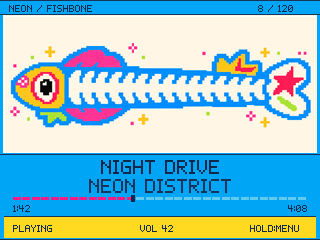

# ESP32-S3 MP3 Player

A reference archive of the ESP32-S3 MP3 player prototype built from off-the-shelf modules: an ESP32-S3 N16R8 dev board, Adafruit ST7789 display with microSD, PCM5102A DAC and non-I2C ANO wheel.

**[Try the interactive UI demo →](https://sdrahul07.github.io/ES32-S3-MP3-Player/)**

Explore all 20 selected concepts, use their playback/library preview controls, and compare them with the saved firmware-rendered screens. The browser demo uses simulated sample tracks and animation, with no music playback or device connection. [Demo details and local setup](docs/DEMO.md).

This repository preserves the module prototype before custom-board development. No custom PCB, KiCad project, fabrication files or integrated-board designs are included. Firmware files are copied unchanged from saved source snapshots.

## Start here

- [Parts and prototype boundaries](docs/HARDWARE.md)
- [Complete wiring and GPIO tables](docs/WIRING.md)
- [Build, upload and restore a checkpoint](docs/BUILDING.md)
- [Controls, brightness and display calibration](docs/CONTROLS.md)
- [History and rollback references](docs/HISTORY.md)
- [Validation status and limitations](docs/VALIDATION.md)

## Preserved checkpoints

| Checkpoint | Sketch | Purpose |
|---|---|---|
| Initial PCM5102A prototype | `firmware/CyberPlayer/CyberPlayer.ino` | Earlier MP3 player, library browsing, optional embedded JPEG artwork |
| Latest module prototype | `firmware/StrandPlayer20/StrandPlayer20.ino` | 20 themes, themed menus, PCM-driven visualizers, scrolling text, brightness and color tuning |
| Audio isolation test | `diagnostics/PCM5102ToneTest/PCM5102ToneTest.ino` | Low-level left 440 Hz / right 660 Hz output without SD or UI |

Both player checkpoints use the same GPIO assignments. The small `.ino` files delegate to neighboring C++ files; keep the entire sketch folder together. Music is MP3 on a FAT32 microSD card. FLAC is outside this baseline.

## Reproduce the archive

Use Arduino IDE 2 and Arduino-ESP32 **3.3.8**, ESP32S3 Dev Module, 16MB flash, OPI PSRAM, and the **3MB APP / 9.9MB FATFS** partition. See the full build guide before flashing.

```powershell
# With arduino-cli available and core 3.3.8 installed:
.\scripts\Build-Prototype.ps1 -Checkpoint Latest
# Upload only when an explicit current port is supplied:
.\scripts\Build-Prototype.ps1 -Checkpoint Latest -Upload -Port COM6
```

The bundled libraries preserve the archived versions. `python scripts/verify-snapshot.py` checks every preserved file against its recorded SHA-256 hash.

The owner reported working song playback on the module prototype. This archive was checked for source preservation and wiring consistency; it is **not a newly hardware-tested release or a verified binary**. Historical test reports describe desktop renderer tests and a blocked ESP32 compiler launch. On-device animation smoothness and playback continuity need testing on the assembled unit.



Preview images come from the saved C++ renderer, at the device's 320x240 landscape resolution. They are not photographs or a promise of LCD color reproduction.

## Licensing

Bundled dependencies retain their upstream license notices. See [THIRD_PARTY_NOTICES.md](THIRD_PARTY_NOTICES.md). No blanket license is assigned here to project code, artwork or third-party brand marks; public availability does not grant rights beyond applicable notices.
